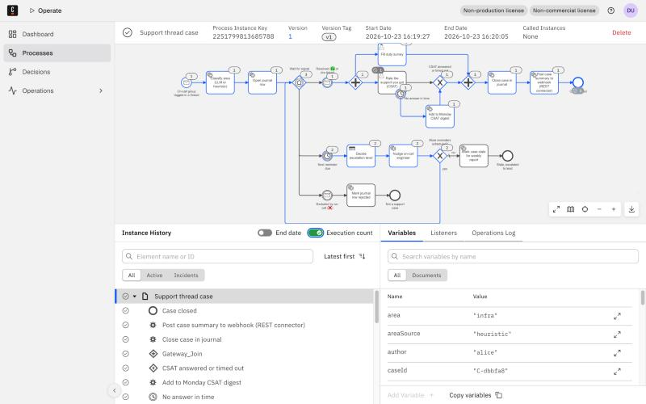
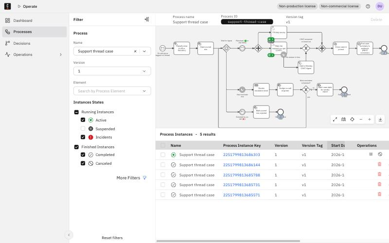
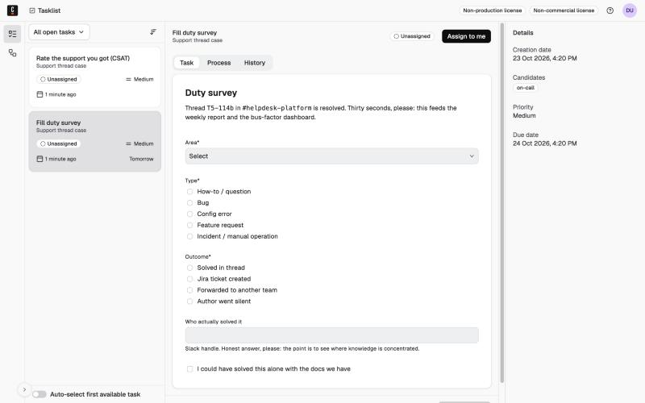
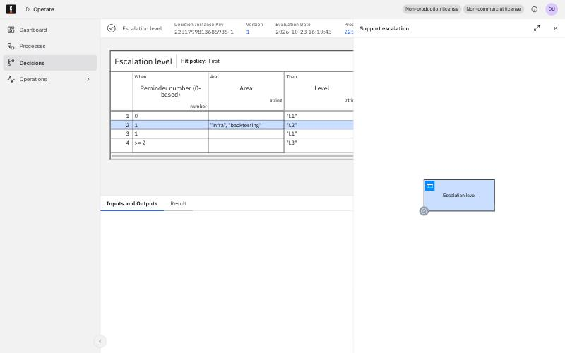

# Support thread case on Camunda 8

A small but complete Camunda 8 project: a BPMN process that turns a Slack support thread
into a tracked case, with reminders, human tasks, a decision table, a connector and a
scheduled report. Hand-written BPMN/DMN/forms, a dependency-free Python worker, and a
one-command demo against a local Camunda 8.10 stack.

Built in an evening to learn Camunda 8 by modelling a process I already run in production
with a hand-rolled Slack bot. The bot is ~12k lines of Python with a scheduler, a journal
table and a lot of state handling. This repo is the same business process expressed as a
model the engine executes, which is the comparison I wanted to make.



## The process

**Business context.** Five platform teams support traders and quants in Slack. A thread that
tags the on-call group is a support case. The on-call engineer should either exclude it
(not support) or get it resolved; afterwards the engineer fills a short duty survey and the
author gets a one-click CSAT prompt. Unanswered CSAT prompts are batched into a Monday
digest; a weekly report goes to the team lead on Friday evening.

**`bpmn/support-thread-case.bpmn`** (one instance per thread):

| Step | BPMN element | Why this element |
|---|---|---|
| On-call group tagged | Message start event, correlation key = `threadId` | One thread = one case. While a case is active, a second tag on the same thread is ignored by the engine, no code needed. |
| Classify area | Service task `classify-area` | LLM if a key is present, keyword heuristic otherwise. The process does not care which. |
| Open journal row | Service task `open-journal-row` | Output mappings also set the model-owned defaults (reminder schedule, CSAT timeout). |
| Wait for signal | Event-based gateway | Whichever comes first: `thread-resolved`, `thread-excluded`, or the next reminder timer. |
| Reminder loop | Timer `=reminderDelays[reminderIndex + 1]` → business rule task → service task `nudge-on-call` → exclusive gateway back | Reminders on day 1, 3 and 10. The DMN table decides who is notified at each step. After the last reminder the case is marked stale. |
| Resolved | Parallel split | Duty survey (on-call engineer) and CSAT (thread author) run in parallel as **user tasks with Camunda Forms**. |
| CSAT not answered | Interrupting boundary timer `=csatTimeout` → service task `add-to-monday-digest` | Merged with the answered path by an exclusive gateway *before* the parallel join (see lessons). |
| Close | Service task `close-case`, then **REST connector** `io.camunda:http-json:1` | Posts the case summary to a webhook. Runs in the Connectors runtime, no custom code. |

**`bpmn/weekly-lead-report.bpmn`**: timer start event with cron `0 5 18 * * FRI`, plus a
none start event for running it on demand. The worker prints a summary from the journal.

**`dmn/escalation-level.dmn`**: `reminderIndex × area → level, notify`. Infra and backtesting
escalate to the team lead one reminder earlier, because historically those are the threads
the on-call engineer cannot solve alone.

**`forms/*.form`**: Camunda Forms (JSON) for the duty survey (area, type, outcome, who
solved it, could-have-solved-alone) and CSAT (👍 / 👎 / 🤷 plus comment).

Timers are process variables with defaults in the model (`P1D`, `P2D`, `P7D`, `P3D`), so the
demo shortens them to seconds without touching the BPMN.

## Run it in 5 minutes

Prerequisites: Docker (tested with Docker 29 on macOS arm64) and Python 3.10+. No pip
installs: the worker uses only the standard library.

```bash
git clone <this repo> && cd camunda-support-case
make up        # pulls camunda/camunda:8.10.6 and camunda/connectors-bundle:8.10.2 (~1.1 GB), starts them
make demo      # deploys everything, runs 5 scenarios, prints a summary (~2 minutes)
```

Then open:

- **Operate** http://localhost:8080/operate (login `demo` / `demo`): process `support-thread-case`,
  five instances. Click the one with the reminder loop to see the token path through the
  timer, the decision and back to the gateway. The decision instances are under *Decisions*.
- **Tasklist** http://localhost:8080/tasklist: the last scenario leaves *Fill duty survey* and
  *Rate the support you got* open. Claim one, fill the form, complete it. Keep
  `make worker` running in another terminal so the close-case job and the connector fire.

`make clean` removes containers, volumes and the local journal.

What the demo runs (`worker/run_demo.py`):

| Scenario | What happens | Ends in |
|---|---|---|
| 1 | Tagged twice (second tag ignored), resolved, survey + CSAT answered via API | Case closed, webhook posted |
| 2 | On-call excludes the thread | Not a support case |
| 3 | Two reminders fire (L1, then L2 with team lead), resolved late, survey filled, CSAT times out | Monday digest, case closed |
| 4 | Nobody reacts, three reminders (last one L3), no signal | Stale, flagged for the weekly report |
| 5 | Resolved, forms left open | Waiting for you in Tasklist |
| + | `weekly-lead-report` started on demand | Report printed from the journal |

The worker's side effects are visible in `.data/journal.json` and `.data/monday-digest.json`.

## Screenshots

| | |
|---|---|
|  Five instances of `support-thread-case` in Operate |  The duty survey form rendered by Tasklist |
|  DMN evaluation for the second reminder of an infra thread: rule 2, level L2 |  Scenario 3: two reminders, late resolution, CSAT timeout, webhook |

## Layout

```
bpmn/      support-thread-case.bpmn, weekly-lead-report.bpmn
dmn/       escalation-level.dmn
forms/     duty-survey.form, csat.form
worker/    c8.py        minimal client for the Orchestration Cluster REST API v2 (stdlib only)
           handlers.py  one function per job type; file-based journal
           worker.py    long-polling job worker, one thread per type
           run_demo.py  deploy + scenarios
           classify.py  area classification (Claude via the anthropic SDK if ANTHROPIC_API_KEY is set, else heuristic)
docker-compose.yaml   Orchestration Cluster 8.10 on H2 + Connectors runtime, derived from the official lightweight distribution
docs/      screenshots
```

The worker talks to the **REST API v2** rather than gRPC on purpose: no SDK, no protobuf,
every call is a readable JSON request you can replay with curl. Job activation is long
polling (`POST /v2/jobs/activation`), the same mechanism the SDKs use underneath.

## What I learned about Camunda 8

Honest notes from a first contact, in the order I hit them.

1. **A parallel join waits for every incoming flow, and the engine will not warn you.** My
   first model wired both the "CSAT answered" and the "CSAT timed out" paths straight into
   the join. The boundary timer is interrupting, so only one of them can ever arrive, and the
   instance sat in Operate forever with no incident. The fix is a merging exclusive gateway
   before the join. Operate's element-instance view made the diagnosis a two-minute job, which
   is the whole argument for an engine over a hand-written state machine: in my bot that bug
   would have been a row with a wrong status and nobody looking.
2. **Correlation keys on message start events are an idempotency primitive for free.** "One
   thread = one case" cost me a scanner, a `rejected` status and a uniqueness constraint in
   the bot. Here it is one attribute. The nuance: a message published with a TTL is *buffered*
   and will start a new instance once the first one completes. Publish facts (a tag happened)
   with TTL 0; publish commands you want delivered (resolved, excluded) with a TTL.
3. **Defaults belong in the model, not in the caller.** Output mappings with FEEL
   (`if csatTimeout = null then "P3D" else csatTimeout`) let the process own its schedule while
   tests and demos override it per instance. Timer durations as expressions over a list
   (`reminderDelays[reminderIndex + 1]`) replace what was a cron job plus a database column.
4. **A timer-only process cannot be started by hand.** `POST /process-instances` rejects it with
   "no none start event". The remedy is a second, plain start event. Obvious in hindsight,
   not documented where I was looking.
5. **8.10 is pleasantly small.** One container (Zeebe, Operate, Tasklist and the REST API in one
   JVM) on file-based H2, no Elasticsearch. The unified REST API v2 is complete enough that a
   250-line stdlib client covers deploy, start, messages, jobs, user tasks and searches. Two
   things I had to find out by trial: keys are strings in search filters (`"processInstanceKey":
   "225..."`), and the deployment response lists every resource kind for every item with the
   non-matching ones set to `null`.
6. **Connectors are a good place to stop writing code.** The REST connector step is pure
   configuration in the BPMN (`io.camunda:http-json:1` with input mappings) and the Connectors
   runtime does the HTTP call, retries and incidents. In the real system that would be the
   Slack connector too, which would remove most of the bot's remaining code.

## Not in scope

No authentication (the local API is unprotected by design), no real Slack integration, no
persistence beyond a JSON file. The purpose was the process model and the engine, not the
integrations around it.
